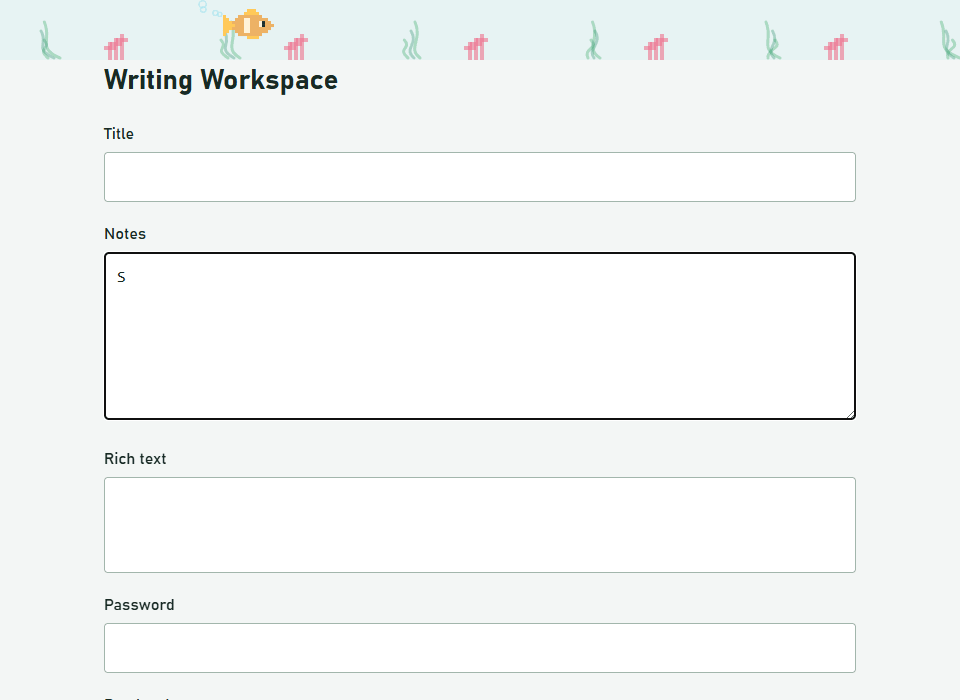
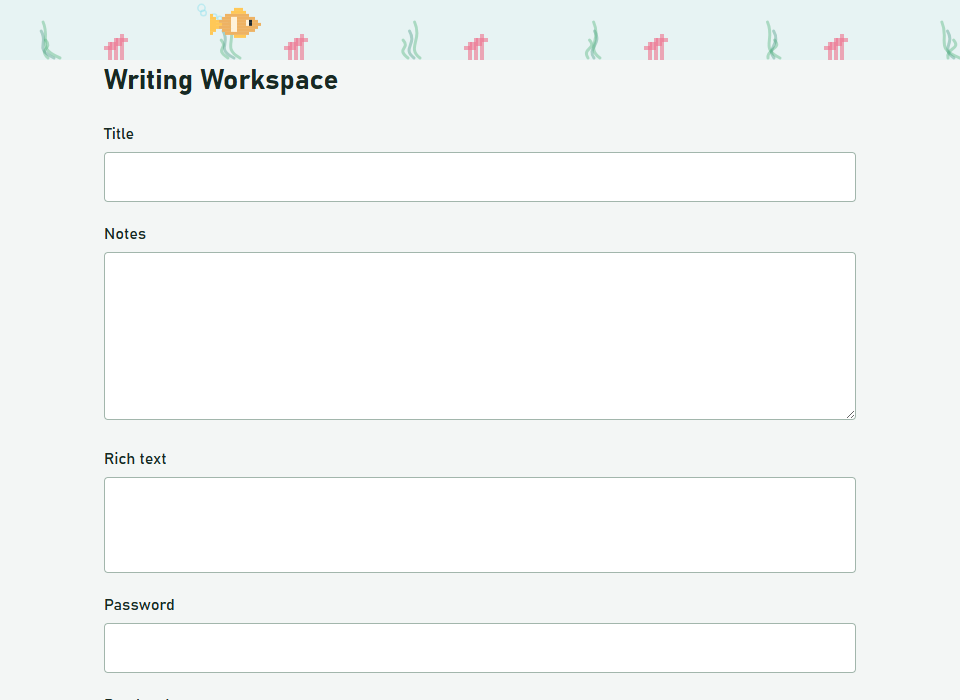
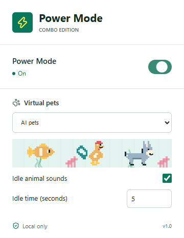

# Developer Power Mode Combo

Inspired by Google Colab's Power Mode and virtual pets: type to build combos and create neon sparks while original pixel-art fish swim with occasional bubbles, or a colorful smiling rooster and a smiling donkey stroll across your active webpage. Pets grow every five seconds and appear at different heights throughout the page. Coral and swaying seaweed decorate the ocean strip at the top. Pets keep moving even when you are not typing and can make their own sounds when you are idle.

This is an independent project, not a Google product. It does not use Google Colab's artwork. Pets appear inside the webpage, not on Chrome's tab bar or toolbar.

This is a local experiment. Chrome Web Store publishing is not needed.

## Preview

The looping GIF below is captured from the actual extension. It shows typing combos, fish with bubbles and an ocean strip, followed by a smiling rooster and donkey. Pets grow in five-second steps and appear farther down the page. GIFs do not contain audio; idle sounds play only in the installed extension. Reduced-motion users can use the still screenshots below instead.



### Ocean Scene



### Pet Settings



## Install In Chrome

Requires desktop Google Chrome 120 or later. No account, API key, or internet service is needed after installation. This project is installed manually, not through the Chrome Web Store.

### Ready-To-Use Package

1. Extract `release/developer-power-mode-combo.zip` into a permanent folder. Do not select the ZIP itself in Chrome.
2. Open `chrome://extensions` in Chrome.
3. Turn on **Developer mode** in the top-right corner.
4. Click **Load unpacked** and select the extracted folder containing `manifest.json`.
5. Confirm **Developer Power Mode Combo** appears without errors.
6. Open Chrome's Extensions menu (the puzzle-piece icon) and pin **Developer Power Mode Combo**.
7. Refresh any webpages that were already open when you installed it.

On this development machine, `release/unpacked` is already prepared and can be selected directly in step 4. Keep the installed folder in place; Chrome loads the extension from it.

### Installing From Source

The source checkout needs a build first. With Node.js 22 or later installed, run these commands in the project folder:

```powershell
npm ci
npm run package
```

Then follow the Chrome steps above using `release/unpacked`. The packaging command also creates the ZIP for sharing with other users; recipients do not need Node.js.

## Use Power Mode

1. Click the pinned extension icon and turn **Power Mode** on. It is off by default.
2. Choose **All pets**, **Ocean fish**, **Rooster**, **Donkey**, or **Off** in the **Virtual pets** menu. Pets start without any keyboard input and keep moving while the page is visible. Turning pets off keeps typing effects enabled.
3. Select **Ocean fish** for swimming fish, occasional rising bubbles, coral, and swaying seaweed in a translucent water strip. Select **Rooster** or **Donkey** for smiling walking animals, or **All pets** to cycle through all three species.
4. Focus an ordinary text input, textarea, or rich-text editor on an HTTP/HTTPS webpage and type continuously. At three edits the counter and caret sparks appear; every ten edits triggers a celebration and subtle overlay shake.
5. A pause of 1.5 seconds ends only the combo. Pets continue independently, including when you change editors. Hidden pages pause animation and restart when visible. Turn Power Mode off to remove all effects.

Pets start small and increase in size every five visible seconds, reaching at most three times their original size after 30 seconds when the viewport has room. New pets inherit the current size and appear in top, middle, or lower lanes; spawning uses five-second intervals or restarts when the previous pets have left. Growth resets when you change the pet mode, disable effects, or hide and return to the page. Smaller viewports automatically limit pet size.

At most three pets, 24 short-lived bubbles, and 150 typing particles are active at a time. The pet renderer is capped near 30 frames per second. Spacing accounts for the larger sprites. Water, coral, and seaweed stay in the top 60 pixels; pets and their bubbles can appear throughout the viewport. All effects remain click-through. Only the visual overlay shakes; your webpage layout does not move.

Your enable setting, pet choice, sound preference, and idle time are remembered locally and apply to eligible open tabs. Existing corgi, kitty, and octopus selections migrate to donkey, rooster, and fish respectively. If your operating system requests reduced motion, only the static counter appears: pets, sounds, sparks, and shaking are disabled.

### Idle Animal Sounds

**Idle animal sounds** is on by default and can be unchecked in the popup. Set **Idle time (seconds)** to a whole number from 1 to 3,600; the default is 5 seconds. Existing saved intervals are preserved. Changes are saved locally and restart the idle countdown on open pages. This setting affects only animal calls, not the 1.5-second typing-combo timeout.

Audio is prepared automatically when saved settings are loaded; you do not need to change a setting to start it. If Chrome blocks autoplay, a click, touch release, or keypress on the webpage unlocks the prepared context. The selected time without keyboard, pointer, touch, or scroll activity then triggers a call from a visible animal: synthesized bubbling for fish, a real recorded rooster crow ("cock-a-doodle-doo"), or a real recorded donkey bray ("hee-haw").

Calls repeat no more often than the selected interval while idle, and recordings never overlap. Each recorded call plays for at most 5.5 seconds and is stopped immediately when muted or the page loses focus. Timing uses real elapsed seconds, independently of the animation frame rate. Recordings are bundled with the extension and work offline; there are no runtime audio downloads.

Idle means no detected interaction inside the webpage; the extension does not inspect videos, CSS animations, or arbitrary page motion. Page typing, pointer movement, clicks, touch, and scrolling reset the countdown. Changing computer volume, system volume keys, audio-device changes, and switching focus to external controls do not count as page interaction or cancel idle. The countdown continues while the visible page is unfocused, and returning focus preserves elapsed idle time rather than starting another full interval.

Pets continue moving during idle periods. Sounds stop when muted, pets are off, Power Mode is disabled, the page loses focus or is hidden, or reduced motion is enabled. Focus loss suspends playback without discarding the unlocked context; playback resumes on return, with a call eligible immediately if the idle interval has already elapsed. Hidden pages pause animation and start a new visible session on return. Chrome autoplay restrictions may require a webpage gesture the first time, including after a refresh.

Reloading or navigating to another eligible URL restores your saved audio preferences and prepares a new audio context automatically. You do not need to change an extension setting. Each new document is subject to Chrome's autoplay policy, so click, tap, or press a key on the new webpage if sound is blocked, then wait for the selected idle interval.

Audio recovery watches context-state and output-device changes, with a guarded retry while the page is focused. Unexpectedly suspended or interrupted contexts are resumed; unexpectedly closed contexts are recreated and their recordings reloaded. Recovery never resets idle time. Intentional pauses, hidden pages, and disabled sound remain silent. After adjusting system volume or changing speakers, return focus to the webpage; only the remaining idle time, if any, is needed. The extension cannot override a muted tab, muted system output, zero volume, or an unavailable audio device.

### Recording Credits

The rooster recording is **Rooster crowing** by **Georgethewriter**, licensed under [CC BY-SA 3.0](https://creativecommons.org/licenses/by-sa/3.0/). The donkey recording is by **Felix Blume**, released under [CC0 1.0](https://creativecommons.org/publicdomain/zero/1.0/). Both original recordings are included unchanged; playback uses a short excerpt when necessary. Sources and full attribution are in [Animal Recording Credits](assets/audio/README.md), which is included in the release package. These licenses apply to the recordings; no endorsement by their creators is implied.

## Privacy And Site Access

The extension asks for website access so its content script can detect edits and render effects on HTTP/HTTPS pages, and `storage` access to remember your settings. Typed text is not saved, logged, or transmitted. Caret positioning temporarily measures the current non-password field locally. Password fields are excluded. There is no analytics, network API, background worker, or remote executable code.

You can restrict site access using Chrome's extension details page. Effects will only work where Chrome allows the extension to run.

## Troubleshooting

| Symptom | What to check |
| --- | --- |
| Nothing happens | Enable Power Mode, refresh the page, and check Chrome's site-access setting. Typing effects also require an editable field. |
| No pets or sparks | Check reduced-motion settings. Select a pet choice other than Off; sparks require a streak of at least three edits. |
| No water, coral, or seaweed | Select Ocean fish or All pets. The background is confined to the top-edge pet strip. |
| No animal sound | Enable Idle animal sounds, set Idle time to 3 seconds for a quick check, click or press a key on the webpage, then leave it focused without moving the pointer. Pets must be enabled and reduced motion must be off. Check that the tab, Chrome, and your system output are not muted. Reload the extension and refresh the page after updating. GIF previews are silent. |
| Sound stops after reloading or opening another URL | Saved preferences restore automatically, but Chrome may require a click, tap, or keypress on the new page. Leave it focused for the configured idle interval; no settings change is needed. |
| Sound stops after changing volume or output device | Return focus to the webpage after closing the system volume controls. Volume changes do not restart idle; playback resumes using the elapsed countdown. Check that the selected output device is available, unmuted, and above zero volume. |
| No effects on Chrome settings or the Web Store | These are restricted browser surfaces; normal content scripts cannot run there. |
| Effects do not work in a custom editor | Google Docs, Monaco, CodeMirror, canvas editors, closed shadow roots, and iframe-based editors are not guaranteed. Try a normal textarea. |
| Cannot load the extension | Select the folder containing the manifest, not its parent or ZIP. From source, build first so `dist/content.js` and `dist/popup.js` exist. |
| Updated files do not appear | Rebuild/repackage, click Reload on the extension card at `chrome://extensions`, then refresh the webpage. |
| Counter appears but caret sparks are offset | Some editor layouts do not expose precise caret coordinates. The extension falls back to the editor's visible bounds. |

File URLs, incognito, iframe coordination, and mobile Chrome are outside the supported installation scope. Ordinary overlays may be covered by browser top-layer dialogs. To uninstall, click **Remove** on the extension card at `chrome://extensions`.

## Development And Tests

```powershell
npm ci
npm run build
npm test
npx playwright install chromium
npm run test:browser
npm run preview
npm run package
```

The browser suite loads the actual unpacked extension in Chromium, serves a temporary local test page, verifies desktop/mobile layouts and canvas pixels, and runs a 60-second sustained-typing check. Test screenshots are generated in `test-results`. Mobile viewport tests validate layout only; they do not imply mobile Chrome extension support.

`npm run preview` captures the actual extension and regenerates the tracked GIF and screenshots in `docs/media`. This opens a temporary local test server and disposable Chromium profile, then closes both. The media are also included in the ZIP so its README previews work when extracted.

## Publish To The Chrome Web Store

These are optional reference notes only; publishing is not part of this experiment.

The extension works as an unpacked installation, but it is **not yet ready for a store submission**. You still need extension icons, store listing images, a public privacy-policy URL, and your publisher/contact details. The current ZIP does not include extension icons. No developer account has been registered or submission made by this project.

### Submission Checklist

1. Register at the [Chrome Web Store Developer Dashboard](https://chrome.google.com/webstore/devconsole). Accept the developer agreement and pay the one-time registration fee shown there. Choose an account you intend to maintain.
2. Complete your publisher profile, verify your contact email, and enable Google Account two-step verification. Complete any additional identity or trader-status requirements shown in your account.
3. Create original PNG icons. Include a 128x128 icon in the extension ZIP, with suitable transparent padding around its artwork. Add an `icons` entry in the manifest; also supply 16, 32, and 48 pixel sizes for browser surfaces, including `action.default_icon`. Update the packaging script to include the icon files before building the upload ZIP.
4. Prepare the store listing: title, short summary, full description, appropriate category, language, and support contact or URL. Avoid implying Google endorsement or promising support for every editor.
5. Prepare a **440x280** small promotional image and at least one **1280x800** or **640x400** screenshot showing actual use. The existing test screenshots are useful previews but are not all store-sized; capture new screenshots at an accepted size rather than stretching them. A **1400x560** marquee is optional.
6. Publish a readable privacy policy at a public HTTPS URL, for example on your existing website or GitHub Pages. Include publisher identity, contact information, an effective date, local processing, local preferences, retention/deletion, and whether anything is shared. Hosting a policy does not require a backend for the extension.
7. Run the unit and browser tests, then `npm run package`. Upload `release/developer-power-mode-combo.zip` using **Add new item**. The manifest must be at the ZIP root. Do not upload the repository, `node_modules`, or a ZIP with an extra enclosing folder.
8. Complete **Store listing**, **Privacy practices**, **Distribution**, and **Test instructions** in the dashboard. Select **Public** distribution for a searchable public listing, or **Unlisted** if you only want to share its direct store link.
9. Submit for review. Choose automatic publishing after approval or deferred publishing so you can release manually. Review times vary, and broad website access can receive additional scrutiny; approval is not guaranteed.

After approval, share the store listing URL. Users can install through **Add to Chrome** without Developer mode. For updates, increase the manifest version, rebuild the ZIP, upload it to the same store item, and submit it for review.

### Suggested Privacy-Practices Entries

Review these against the exact version you upload; they are guidance, not automatic declarations or legal advice.

| Field | Suggested explanation |
| --- | --- |
| Single purpose | Provide optional, local visual feedback while typing: combo counters, caret particles, and animated virtual pets. |
| `storage` | Remember only the user's enable setting, pet selection, sound preference, and idle-time setting locally so preferences persist across browser sessions. |
| HTTP/HTTPS website access | Detect eligible edits and render visual feedback on user-permitted webpages. Website access enables automatic effects across sites; it is not used for history collection, advertising, or transmitting text. |
| Remote code | No remotely hosted executable code. All JavaScript, caret utilities, icons, pet artwork, and animal recordings are bundled with the extension. |

**Local processing still requires disclosure.** Google treats using website content, form data, and interaction information locally as data handling. Do not claim that the extension never handles user data merely because it has no server. Explain that eligible edit events, caret/selection positions, and temporary non-password field content are used only on-device to render effects; typed content is not retained, logged, or transmitted. Review the dashboard's website-content and user-activity categories against Google's current definitions and the submitted implementation.

The policy should also state that password inputs are excluded; only the enable, pet, sound, and idle-time preferences persist in `chrome.storage.local`; users can change preferences in the popup; transient streak/effect and idle activity state is discarded on reset or leaving the page; and uninstalling removes extension-local preferences. Idle detection uses input-event timing locally, without recording input contents or pointer coordinates. No typed content is sold, shared, used for advertising, or made available for human review. Add a Limited Use compliance statement that accurately reflects your product and Google's current requirements.

**Reviewer test instructions:** Install the extension, open the popup, enable Power Mode, choose All pets, and type ten characters in a standard textarea on a permitted HTTP/HTTPS page without a 1.5-second pause. Observe the counter, sparks, overlay shake, and pets. Pause to reset, switch pets, and disable effects. With Idle animal sounds enabled, set Idle time to 3 seconds, click the webpage and leave it focused without interaction to hear a call. Switch away and return without another click to verify audio recovery; uncheck the sound setting to mute. Reopen the popup to verify the idle time persists. No login or credentials are required. If reduced motion is enabled, expect only the static counter.

### Official References

- [Register a developer account](https://developer.chrome.com/docs/webstore/register)
- [Publish an extension](https://developer.chrome.com/docs/webstore/publish)
- [Required listing images](https://developer.chrome.com/docs/webstore/images)
- [Privacy-practices fields](https://developer.chrome.com/docs/webstore/cws-dashboard-privacy)
- [Local data handling and privacy-policy requirements](https://developer.chrome.com/docs/webstore/program-policies/user-data-faq)

## Developer Specification

A Chrome extension that turns continuous typing into a retro-game combo streak, with a floating hit counter, caret-adjacent neon sparks, milestone celebrations, and animated virtual pets. Everything runs locally; no backend, account, API key, or typed-text collection is required.

**Target user:** people who want optional visual feedback while writing, coding, or taking notes in browser-based editors.

**MVP scope:** Chrome Manifest V3, ordinary text inputs, textareas, and standard contenteditable elements on permitted HTTP/HTTPS pages. Specialized editors require separate compatibility testing.

## Core Experience

1. The user enables Power Mode using the extension popup.
2. Each qualifying text edit increases the current streak by one.
3. At three hits, a compact floating counter appears and neon sparks burst near the caret.
4. At ten hits, a brief `10 HITS COMBO!` celebration appears. Higher celebrations occur at 20, 30, and subsequent multiples of ten. Selected pets spawn independently of typing and automatically return after leaving the viewport.
5. A pause of 1,500 ms ends the streak, hides the counter, and lets existing particles fade out.
6. The extension remembers whether effects are enabled. Optional high-score tracking is a later enhancement.

The counter updates on every qualifying edit, but milestone celebrations fire only when a threshold is crossed, not on every hit after ten.

## Functional Requirements

### Typing And Streak Rules

- Observe root-level events in the capture phase without preventing default behavior or stopping propagation.
- Use `keydown` to identify keyboard intent, but count confirmed, trusted `input` edits. Keydown alone can count shortcuts, canceled edits, or keys that never insert text.
- Count text insertion, line breaks, and backward deletion when they change an eligible editable field. A held key counts each resulting edit.
- Exclude modifier-only keys, navigation keys, browser/editor shortcuts, paste, drop, autofill, undo/redo, and programmatic changes.
- During IME composition, suppress intermediate effects and count the committed composition once. Prevent duplicate counting of its final input event.
- Never count or read password fields. Skip read-only, disabled, and non-text inputs.
- Reset on editable-target changes, loss of focus, page hiding, or disabling the extension.
- Check elapsed time on the next edit as well as using one reset timer, so delayed timers cannot preserve an expired streak.
- Do not store, log, transmit, or include typed content in telemetry.

### Visual Effects

- Use one fixed, viewport-sized canvas for particles and an isolated overlay for the counter. All effect elements must be non-focusable and use `pointer-events: none`.
- Keep extension styles isolated from site styles, preferably with a shadow-root host. Do not modify the site's existing transforms or animations.
- Use one `requestAnimationFrame` loop with delta-time motion, a near-30-fps drawing cap, and bounded particles. Keep it active while ambient pets are enabled or typing particles are alive; stop it on hidden pages, reduced motion, or disabling effects.
- Initial tuning: 6-12 sparks per hit, 300-600 ms particle lifetime, and at most 150 live particles per document. Treat these as tunable limits, not performance guarantees.
- Use viewport coordinates for the fixed overlay; resize the canvas on viewport changes and account for device pixel ratio with a sensible rendering cap.
- Provide a subtle overlay shake by default. Heavy page shake is a separate, opt-in compatibility enhancement because transforming the page can break sticky/fixed layouts and conflict with host animations.
- Honor `prefers-reduced-motion`: retain a static counter, but disable particles, shaking, and animated celebrations.
- Hide the visual counter from assistive technology to avoid announcing every keystroke.

### Caret Placement

- For textareas and supported text inputs, use a maintained caret-position utility based on a styled mirror element. Account for font metrics, padding, borders, wrapping, selection, and internal scrolling.
- For contenteditable elements, use the selection range's client rectangles without modifying the live document or selection.
- If the caret cannot be measured, use the focused editor's visible bounds as a stable fallback. Exact caret placement is best effort, not a universal promise.
- Inspect the composed event path for accessible shadow-DOM targets. Closed shadow roots and custom editors may not expose enough information.

### User Controls

- A minimal popup contains a persistent on/off toggle. Changes take effect in already-open eligible tabs.
- Store only the enable preference, pet selection, idle-sound preference, and idle time in `chrome.storage.local`.
- Offer All pets, Ocean fish, Rooster, Donkey, and Off choices. Use original local pixel sprites, with a three-pet cap and no animation or sounds in reduced-motion mode. Fish/All modes add a top-edge water/coral/seaweed scene and bounded rising bubbles; rooster and donkey sprites smile.
- Grow pets in five-second visible-time steps up to three times their original size, constrained by viewport dimensions. Spawn across top, middle, and lower lanes, scale walking details and spacing, and reset growth on pet-mode changes or a new visible session.
- Provide a mute checkbox, a validated 1-3,600-second idle-time input (default 5), synthesized fish bubbles, and bundled real rooster/donkey recordings after the selected time without user interaction. Prepare audio on initial settings load rather than waiting for a preference change. Use real elapsed time, not capped animation deltas. Support webpage gestures to unlock audio when Chrome requires them; suspend on blur/page hiding and resume on focus without requiring a new gesture. Avoid overlapping recordings and stop the current call on blur or muting. Close audio when muting or disabling pets/effects.
- Later controls: per-site exclusions, effect intensity, counter placement, and an explicit heavy-shake toggle.
- Later high-score feature: store the best completed streak locally and provide a reset action. Define cross-tab update behavior before implementing it.

## Extension Architecture

| File | Responsibility |
| --- | --- |
| `manifest.json` | Manifest V3 declaration, content-script matching, popup, and storage permission |
| `src/content.js`, `src/streak.js` | Eligible-edit detection, streak state, and effect lifecycle; bundled into `dist/content.js` |
| `src/caret.js`, `src/effects.js` | Caret positioning and isolated counter/particle/pet rendering |
| `assets/audio/` | Bundled licensed rooster/donkey recordings and attribution; decoded and played locally by `src/effects.js` |
| `src/pets.js` | Original fish/rooster/donkey sprites, ambient spawning, bubbles, coral, seaweed, spacing, selection, idle timing, and cleanup |
| `styles.css` | Minimal overlay-host styles; internal styles remain isolated |
| `popup.html`, `popup.js`, `popup.css` | Enable toggle and preference persistence |

- No background service worker is necessary for the MVP. Content scripts can read storage and react to preference changes.
- Use HTTP/HTTPS content-script matches if automatic effects across websites are intended. This grants broad site access and must be explained clearly to users.
- `activeTab` alone does not authorize automatic injection across all sites. A user-activated, single-tab alternative would use `activeTab` plus `scripting` instead of broad automatic matching.
- Include the `storage` permission for preferences. Do not request `tabs`, clipboard, network interception, or other unrelated permissions.
- Bundle all JavaScript and caret utilities locally; do not load executable code from a CDN.
- MVP runs in the top document only. Iframe support is a follow-up that needs frame matching, permissions, and a policy for separate versus shared streaks.

## Compatibility Boundaries

Chrome internal pages, the Chrome Web Store, and other restricted browser surfaces cannot run normal content scripts. File URLs and incognito require separate user permission and are outside the MVP.

Monaco, CodeMirror, Google Docs, canvas-based editors, closed shadow roots, and embedded cross-origin editors may need editor-specific adapters. Their support must not be advertised until verified. Browser top-layer elements such as modal dialogs can also cover an ordinary overlay regardless of its z-index.

## Five-Hour MVP Plan

| Time | Deliverable |
| --- | --- |
| Hour 1 | Manifest, enable toggle, eligible-edit detection, and streak timeout |
| Hour 2 | Isolated counter/canvas overlay and basic caret/fallback placement |
| Hour 3 | Bounded particle engine and milestone celebrations |
| Hours 4-5 | Reduced-motion behavior, lifecycle cleanup, focused tests, and unpacked-extension smoke testing |

This is a prototype estimate, assuming an experienced developer and reuse of a caret-position utility. Broad editor support, heavy page shake, high scores, store publishing, and extensive compatibility testing are additional work.

## Acceptance Criteria

- Three qualifying edits show the counter; ten produce exactly one milestone celebration.
- An edit after a gap of at least 1,500 ms starts a fresh streak at one, including when timer callbacks were delayed.
- Password entry, ordinary page navigation, shortcuts, paste, and programmatic edits produce no effects.
- IME commit increments once; intermediate composition events do not increment.
- Text entry, selection, clicks, scrolling, and host keyboard shortcuts remain unchanged.
- Caret particles remain anchored while a supported textarea scrolls; unavailable measurements use the documented fallback.
- Disabling effects immediately resets the streak, clears particles, and stops animation work. Re-enabling does not duplicate listeners or overlays.
- Hiding the page clears the streak and stops animation; reduced-motion mode shows only a static counter.
- Pets grow at five-second boundaries, appear beyond the top strip, remain within viewport size limits, and never intercept page interaction.
- Audio preferences restore after reload and URL navigation; interrupted/closed audio contexts recover without changing settings, while Chrome's autoplay and system-mute restrictions remain respected.
- Only interaction inside the page cancels idle; system volume keys, external-control focus changes, and audio recovery preserve elapsed idle time.
- A sustained 60-second typing test stays within the particle cap and shows no extension-attributable long tasks over 50 ms on the recorded test machine.
- Test streak boundaries with fake time; smoke-test input, textarea, contenteditable, IME, scrolling, reduced motion, and a restricted-page case in Chrome.

## Developer Handoff Prompt

> Build the experiment described in this README as a local-only Chrome Manifest V3 extension. Use a content script, isolated counter overlay, bounded HTML5 Canvas particle engine, original fish/rooster/donkey pets, and popup controls persisted through chrome.storage.local. Animate selected pets independently of keyboard input, with occasional fish bubbles, coral, and swaying seaweed in a narrow top-edge water scene, and smiling rooster/donkey sprites with recognizable silhouettes. Bundle licensed real rooster/donkey calls with attribution and synthesize fish bubbles. Prepare audio on initial settings load, support gesture unlocking when required by Chrome, and use a saved 1-3,600-second idle delay defaulting to 5 seconds. Use real elapsed seconds and preserve unlocked audio across blur/hiding by suspending and resuming on focus; stop active recordings on blur and never overlap them. Track confirmed keyboard-driven edits in eligible text fields. Show the counter at three hits, celebrate every ten hits, and reset only the combo after 1,500 ms of inactivity. Keep a three-pet cap, bound bubbles and particles, and pause ambient work and audio on hidden pages or reduced motion. Reuse a bundled caret-position utility and Selection/Range with a fallback. Preserve host-page behavior, exclude passwords, support IME commits, and clean up timers, audio, and animation state. Implement and test the acceptance criteria. Leave publishing, heavy page shake, iframe coordination, specialized editor adapters, and high scores outside the experiment.
